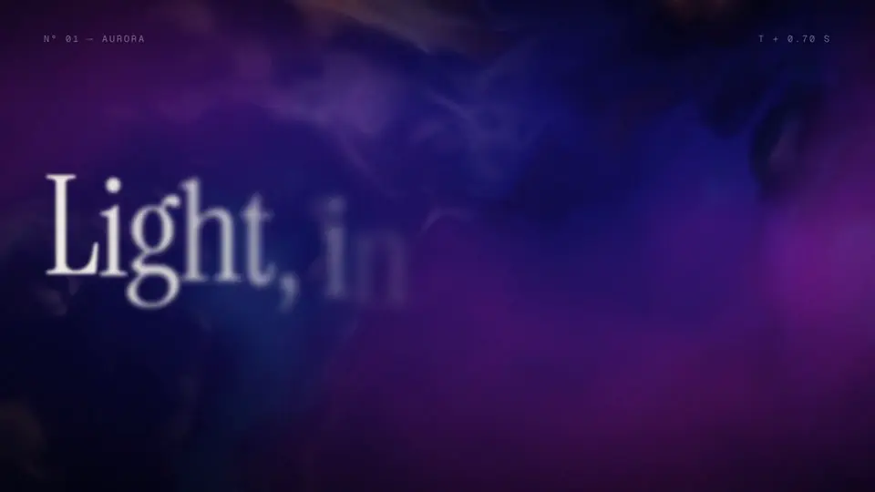

<p align="center">
  
</p>

<h1 align="center">Valle</h1>

<p align="center">
  <strong>为 AI Agent 打造的视频引擎。</strong><br>
  Agent 用代码写视频，Valle 负责检查、把画面给它看、再在你的电脑上原生渲染出来。
</p>

<p align="center">
  <a href="README.md">English</a> · 简体中文
</p>

<p align="center">
  
</p>

你的 Agent 本来就会写 React、CSS 和 JSON。有了 Valle，这些就足够做视频了：动画是 TSX
组件，剪辑是一份 JSON 时间线。不用操作剪辑软件，也不用拿浏览器截图，只是 Agent 能写、能检查、
能渲染的文件。

```tsx
// title.motion.tsx
export const composition = { width: 1920, height: 1080, fps: 30, duration: 3 };

export default function Title() {
  const { seconds } = useCurrentTime();
  const shown = interpolate(seconds, [0, 0.8], [0, 1], { easing: "easeOutExpo" });
  return (
    <View className="grid size-full place-items-center bg-linear-to-br from-indigo-600 to-fuchsia-500">
      <Text className="text-9xl font-black text-white" style={{ opacity: shown }}>
        Hello, Valle
      </Text>
    </View>
  );
}
```

```json
// edit.timeline.json：标题淡入到一段素材
{
  "canvas": { "width": 1920, "height": 1080, "fps": 30 },
  "resources": { "title": "title.motion.tsx", "clip": "clip.mp4" },
  "tracks": {
    "visual": [{ "items": [
      { "id": "title", "kind": "motion", "component": "title", "duration": 2 },
      { "transition": "fade", "inOffset": 0.4, "outOffset": 0.4 },
      { "id": "shot", "kind": "video", "src": "clip", "trimStart": 0.5, "duration": 2.5 }
    ] }]
  }
}
```

```sh
valle timeline check edit.timeline.json                            # 渲染前检查每一帧
valle timeline render edit.timeline.json --storyboard -o sheet.png # 看画面
valle timeline render edit.timeline.json -o edit.mp4               # 渲染成片
```

## 为什么选 Valle

**视频就是代码。** 场景是组件，支持 Flexbox、Grid 和 Tailwind；剪辑是 JSON，有轨道、转场和
关键帧。可以 diff、可以 review、可以重新生成。

**Agent 看得见自己做了什么。** Agent 看不了视频，所以 Valle 把画面交给它：任意一帧导出成
PNG，或者把很多帧排成一张故事板。出了错，`check` 会指出是哪一行、哪个字段，以及应该写什么。

**原生渲染，不靠浏览器。** 每一帧都由 Valle 自己用 Rust 写的引擎在 GPU 上绘制。没有无头
Chrome，没有截图：同样的输入，在任何机器上都得到同样的像素。

**一个文件，在你的电脑上。** 命令行、渲染器和 Studio（让人旁观和调整 Agent 作品的编辑器）
都在一个可执行文件里，支持 macOS、Linux 和 Windows。不需要云服务，不需要注册账号。

## 能做什么

动画、剪辑、字幕和着色器。上面这段 reel 就是一份时间线，用
[`examples/showcase`](examples/showcase) 十个场景里的五个剪出来的，每个场景只有一个文件。

## 开始使用

1. **安装** Valle：
   ```sh
   curl -fsSL https://openvalle.ai/install.sh | sh        # macOS 和 Linux
   irm https://openvalle.ai/install.ps1 | iex             # Windows
   ```
   渲染视频还需要 FFmpeg：macOS 上 `brew install ffmpeg`，其他平台见
   [安装文档](docs/install.md)。
2. **给 Agent 装上 skill**：
   ```sh
   npx skills add openvalle/valle
   ```
3. **让它做视频**。比如"给我们的 App 做一个 10 秒的发布视频"、"把这几段素材剪在一起，加上标题
   和字幕"。Agent 会写文件、检查、看画面、渲染，你可以在 Studio 里旁观：`valle project studio`。

[安装](docs/install.md) · [入门](docs/start.md) · [Motion](docs/motion.md) ·
[Timeline](docs/timeline.md) · [Project](docs/project.md) · [CLI](docs/cli.md) ·
[浏览器引擎](web/packages/engine)

---

Valle 0.1 还处在早期：会有不完善的地方，版本之间也可能有不兼容的改动。上一个版本存档在
[`archive/v0`](https://github.com/openvalle/valle/tree/archive/v0)。
[Apache-2.0](LICENSE) · [第三方软件](THIRD_PARTY.md)
